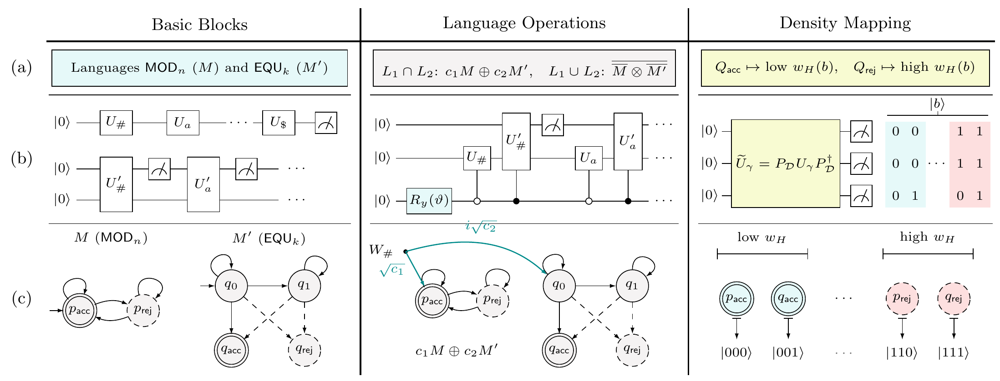
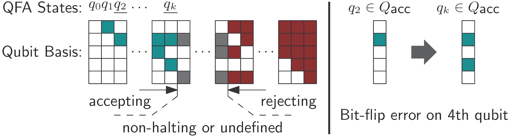
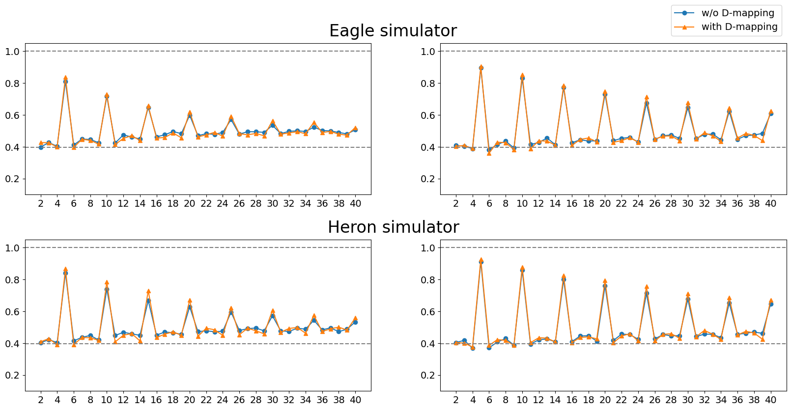
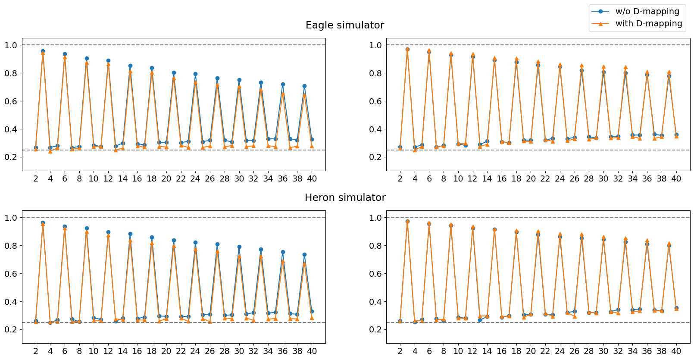
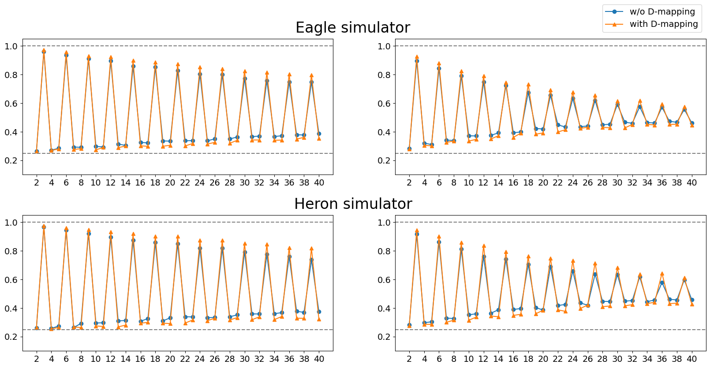
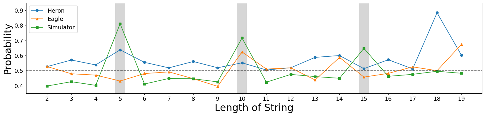

# QFA-Toolkit: A Framework for Quantum Finite-State Languages with Density Mapping

<!--toc:start-->
- [QFA-Toolkit: A Framework for Quantum Finite-State Languages with Density Mapping](#qfa-toolkit-a-framework-for-quantum-finite-state-languages-with-density-mapping)
  - [TL;DR](#tldr)
  - [About QFA-Toolkit](#about-qfa-toolkit)
    - [Density Mapping](#density-mapping)
      - [Experimental Results](#experimental-results)
  - [Dependency and Installation](#dependency-and-installation)
  - [Quick Tour](#quick-tour)
  - [Functionalities](#functionalities)
  - [Reading Materials for QFA](#reading-materials-for-qfa)
  - [Test](#test)
  - [Citation](#citation)
<!--toc:end-->

## TL;DR

QFA-Toolkit is a framework for constructing quantum finite-state automata
(QFAs) and quantum finite-state languages (QFLs). It provides:

1.  Parameterized constructions of QFAs for unary modulo languages (`MOD_p`)
    and unary singleton languages (`EQU_k`).
2.  A systematic method for combining simple QFAs with language operations
    (intersection, union, complement, linear combination, word quotient, and
    inverse homomorphism) to compose complex QFAs.
3.  A transpilation process from QFAs to quantum circuits using *density
    mapping* (D-mapping) for improved simulation and execution accuracy on noisy
    quantum devices.

## About QFA-Toolkit

Constructing quantum finite-state automata (QFAs) from scratch is challenging
for those without deep background in quantum mechanics or formal language theory.
This complexity arises from the constraints on transitions in QFAs, where
transitions must adhere to the properties of unitary matrices. Moreover, even
properly constructed QFAs are prone to practical execution results that deviate
from theoretical expectations due to noise on current quantum computers, which
can alter the bit-representation of QFA states during circuit execution.

QFA-Toolkit addresses these challenges and improves accuracy by providing
intuitive QFA composition methods alongside improvements to the transpilation
process from QFAs to quantum circuits. The intended workflow of our framework
is threefold: (1) constructing simple baseline QFAs, (2) combining these simple
QFAs with language operations to compose a complex QFA, and (3) transpiling the
resulting complex QFA into a quantum circuit using *density mapping*.



### Density Mapping

We introduce *density mapping* (D-mapping), a state-to-basis mapping strategy
employed during transpilation. Because physical qubits experience asymmetric
relaxation ($T_1$ decay from $|1\rangle$ toward $|0\rangle$) and readout errors,
D-mapping assigns accepting states to computational basis states with fewer `1`
bits (lower Hamming weight) and rejecting states to basis states with more `1`
bits (higher Hamming weight), placing unused padding basis states in the middle
to act as a buffer against bit-flip and relaxation errors.



#### Experimental Results

We evaluate D-mapping against naive mapping across IBM Falcon (`ibm_cairo`),
IBM Eagle (`ibm_sherbrooke`), and IBM Heron (`ibm_torino`) noise models as well
as on real quantum hardware (`ibm_sherbrooke`).

The following figure compares the accepting probabilities under naive mapping
and D-mapping for the unary modulo language `MOD_5` across Eagle and Heron
noise models at error scaling factors `1.0x` and `0.5x`:



Across 10-state, 16-state, and 18-state QFAs, D-mapping consistently reduces
mean absolute percentage error (MAPE) and improves the separation margin
between accepting and rejecting inputs:





Execution on the real `ibm_sherbrooke` quantum processor further confirms that
D-mapping preserves a clearer decision boundary for language recognition:



## Dependency and Installation

Our dependencies are managed by `pyproject.toml`.
The main dependencies are `numpy`, `scipy`, and `qiskit`.

You can install the package with the following commands:
```bash
git clone https://github.com/sybaik1/qfa-toolkit.git
cd qfa-toolkit
pip install .
```

## Quick Tour

You can import `qfa_toolkit` as a Python package to construct and test your QFA
or QFL. Building a QFA directly can be done by defining the transition matrices
and accepting (and rejecting) states:

```python
import numpy as np
import math
from qfa_toolkit.quantum_finite_state_automaton import (
    MeasureOnceQuantumFiniteStateAutomaton as Moqfa)

# MO-QFA construction
theta = math.pi / 3
a, b = math.cos(theta), math.sin(theta)
acceptings = np.array([1, 0], dtype=bool)
transitions = np.array([
    [
        [1, 0],
        [0, 1],
    ],
    [
        [a, b],
        [-b, a],
    ],
    [
        [1, 0],
        [0, 1],
    ],
], dtype=np.cdouble)
moqfa = Moqfa(transitions, acceptings)
```

To build a QFL, provide a recognition strategy alongside the QFA, or use the
built-in parameterized language constructors (`Moqfl.from_modulo`,
`Moqfl.from_modulo_prime`, `Mmqfl.from_unary_singleton`,
`Mmqfl.from_unary_finite`) and compose them with language operations:

```python
from qfa_toolkit.quantum_finite_state_automaton_language import (
    MeasureOnceQuantumFiniteStateAutomatonLanguage as Moqfl,
    MeasureManyQuantumFiniteStateAutomatonLanguage as Mmqfl,
)
from qfa_toolkit.recognition_strategy import (
    NegativeOneSidedBoundedError as NegOneSided)

# Direct MOQFL construction
strategy = NegOneSided(0.5)
moqfl = Moqfl(moqfa, strategy)

# Composing (MOD_3 & MOD_5) | EQU_4 from parameterized baseline QFLs
mod_3 = Moqfl.from_modulo(3)
mod_5 = Moqfl.from_modulo(5)
mod_15 = (mod_3 & mod_5).to_measure_many_quantum_finite_state_automaton_language()
equ_4 = Mmqfl.from_unary_singleton(4)
composed_qfl = mod_15 | equ_4
```

You can transpile a QFA into a Qiskit `QuantumCircuit` (with density mapping
enabled by default via `use_density_mapping=True`) and simulate it:

```python
from qiskit import transpile
from qiskit_aer import AerSimulator
from qfa_toolkit.qiskit_converter import (
    QiskitMeasureOnceQuantumFiniteStateAutomaton as QMoqfa)

# Circuit initialization with density mapping
qiskit_moqfa = QMoqfa(moqfa, use_density_mapping=True)
word = [1] * 3
circuit = qiskit_moqfa.get_circuit_for_string(word)

# Circuit simulation on Qiskit Aer
simulator = AerSimulator()
compiled_circuit = transpile(circuit, simulator)
job = simulator.run(compiled_circuit, shots=10000)
result = job.result()
counts = {
    int(k, base=2): v
    for k, v in result.get_counts().items()
}
observed_acceptance = sum(
    counts.get(state, 0) for state in qiskit_moqfa.accepting_states)
observed_rejectance = sum(
    counts.get(state, 0) for state in qiskit_moqfa.rejecting_states)
print(f'acceptance: {observed_acceptance}\n'
      f'rejectance: {observed_rejectance}')
```

## Functionalities

See the API documentation ([link](./document.md)) for details on each module and
class.

## Reading Materials for QFA

If you are new to QFAs and want to learn the fundamentals, see
([link](https://is.muni.cz/th/dy49n/b-thesis-QFA.pdf)).

## Test

Testing uses Python's standard `unittest` module (with `scipy` for statistical
circuit tests). Within the installed environment, run:

```bash
python3 -m unittest
```

## Citation

```bibtex
@misc{BaikSH24,
    title={A Framework for Quantum Finite-State Languages with Density Mapping},
    author={SeungYeop Baik and Sicheol Sung and Yo-Sub Han},
    year={2024},
    eprint={2407.02776},
    archivePrefix={arXiv},
    primaryClass={cs.CL},
    url={https://arxiv.org/abs/2407.02776},
}
```
