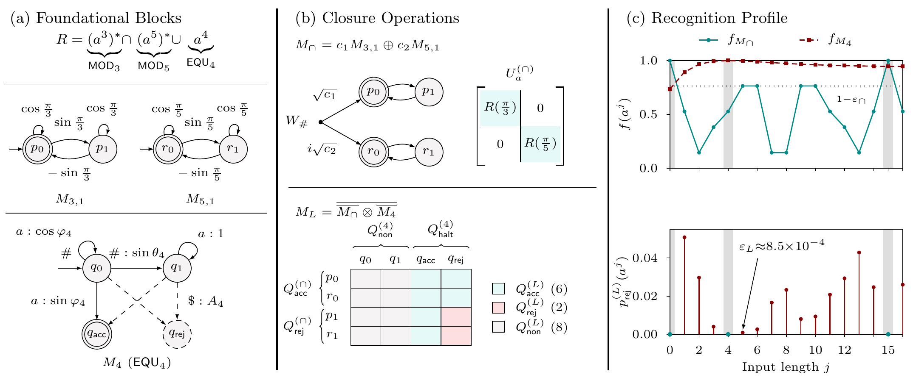
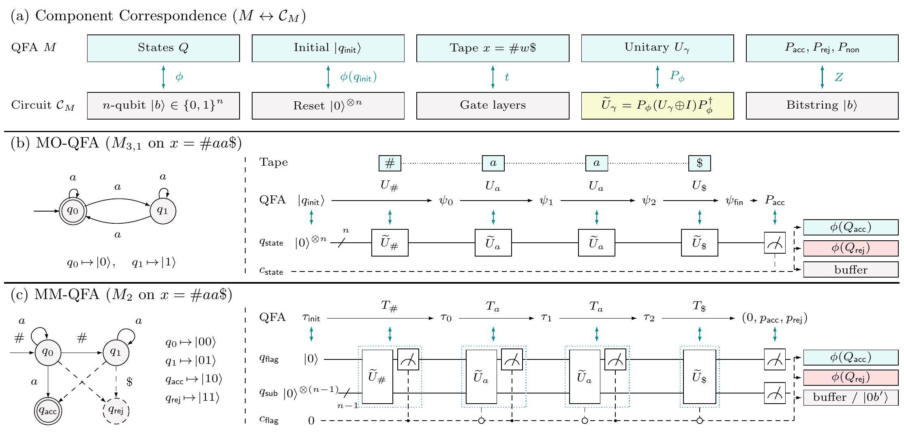
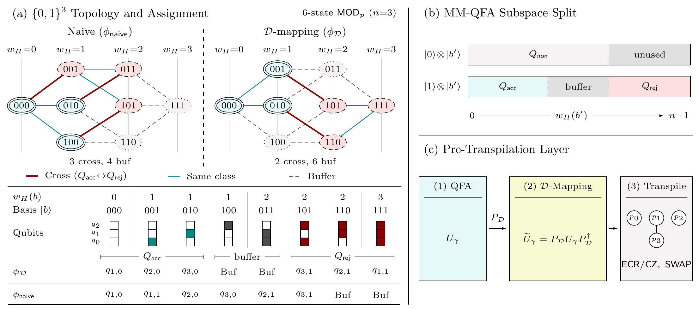
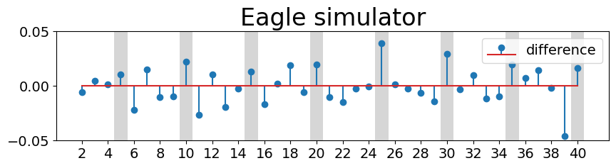
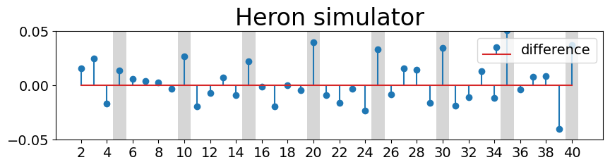

# QFA-Toolkit: A Framework for Quantum Finite-State Languages with Density Mapping

<!--toc:start-->
- [QFA-Toolkit: A Framework for Quantum Finite-State Languages with Density Mapping](#qfa-toolkit-a-framework-for-quantum-finite-state-languages-with-density-mapping)
  - [TL;DR](#tldr)
  - [About QFA-Toolkit](#about-qfa-toolkit)
    - [Composition and Circuit Compilation](#composition-and-circuit-compilation)
    - [Density Mapping](#density-mapping)
    - [Experimental Results](#experimental-results)
  - [Dependency and Installation](#dependency-and-installation)
  - [Quick Tour](#quick-tour)
  - [Functionalities](#functionalities)
  - [Datasets and Reproducibility](#datasets-and-reproducibility)
  - [Reading Materials for QFA](#reading-materials-for-qfa)
  - [Test](#test)
  - [Citation](#citation)
<!--toc:end-->

## TL;DR

QFA-Toolkit is a Python and Qiskit framework for constructing, composing, and
compiling quantum finite-state automata (QFAs) and quantum finite-state
languages (QFLs). It provides:

1. Parameterized basic-block constructors for unary periodic languages
   (`MOD_n`, `MOD_p`) and unary singleton/finite languages (`EQU_k`).
2. Systematic algebraic composition via formal language operations
   (intersection, union, complement, convex linear combination, word quotient,
   and inverse homomorphism) grounded in negative one-sided bounded-error
   closure properties of measure-once QFAs (`MO-QFA`) and co-end-decisive
   measure-many QFAs (`MM-QFA`).
3. Pre-transpilation quantum circuit compilation with *density mapping*
   (D-mapping) and mid-circuit halting-flag feedforward (`if_test`) to mitigate
   single-bit-flip measurement errors on noisy quantum simulators and devices.

## About QFA-Toolkit

Constructing QFAs directly from scratch requires enforcing unitary transition
constraints while separating accepting and rejecting strings with a sufficient
error margin. Moreover, executing QFA circuits on noisy quantum hardware
introduces gate, thermal-relaxation, and readout errors that can flip basis
states and distort acceptance probabilities.

QFA-Toolkit streamlines QFA engineering into a three-stage workflow:
(1) instantiating parameterized `MOD_n` and `EQU_k` building blocks,
(2) combining them with language operations to compose composite QFLs, and
(3) compiling the resulting automaton into a Qiskit quantum circuit using
*density mapping* (D-mapping).


### Composition and Circuit Compilation

Periodic (`MOD_n`, recognized by 2-state `MO-QFA`s) and singleton (`EQU_k`,
recognized by 4-state co-end-decisive `MM-QFA`s with optimal parameters)
building blocks compose directly into unified co-end-decisive `MM-QFA`s via
intersection and De Morgan union—for example, compiling `(MOD_3 & MOD_5) | EQU_4`
directly into a 16-state co-end-decisive `MM-QFA`:



During compilation to Qiskit circuits, each QFA state set, initial state, online
tape symbol, unitary operator, and observable projection maps one-to-one onto
$n$-qubit registers (using $n = \lceil \log_2 |Q| \rceil$ qubits for `MO-QFA`s
and $n = 1 + \lceil \log_2 \max(|Q_{\text{halt}}|, |Q_{\text{non}}|) \rceil$
qubits with mid-circuit halting-flag readout and `if_test` classical feedforward
for `MM-QFA`s):



### Density Mapping

To suppress single-bit-flip ($d_H = 1$) misclassifications without adding
ancilla qubits, D-mapping orders $n$-qubit computational basis vectors by Hamming
weight $w_H(b)$ (with sub-register sorting on the halting subspace for `MM-QFA`s).
Accepting states cluster near $|00\cdots 0\rangle$, rejecting states cluster near
$|11\cdots 1\rangle$, and unused basis dimensions remain in the middle as a
post-selected invalid-shot buffer zone:



### Experimental Results

We evaluate D-mapping against naive binary mapping on IBM Quantum **Eagle r3**
and **Heron r2** processors and Qiskit Aer simulators configured with each
processor's native gate set (`ECR, ID, RZ, SX, X` for Eagle; `CZ, ID, RX, RZ,
RZZ, SX, X` for Heron), coupling topology, thermal relaxation ($T_1, T_2$), and
scaled gate and readout mirroring factors $\eta_g, \eta_r \in \{0.1\%, 0.5\%,
1.0\%\}$.

On physical Eagle r3 and Heron r2 hardware, decomposing dense 5-qubit
(`32 x 32`) `MOD_5` unitaries into native gates produces over 1,000 gates even
for length-2 inputs, depolarizing real-device acceptance probabilities near `0.5`
regardless of mapping:


Using scaled-noise Qiskit Aer simulators to isolate the effect of D-mapping
under near-term error rates:

- **Per-string accuracy (`MOD_5`, $\eta_g = \eta_r = 0.5\%$):** D-mapping raises
  acceptance on member strings and lowers false acceptance on non-members,
  reducing MAPE from `19.45%` to `17.90%` on Eagle and from `16.70%` to
  `15.77%` on Heron:

  

  

- **Overall `MOD_p` benchmark (`p in {3, 5, 7}`):** Across all 54 simulator
  configurations, D-mapping improves MAPE in 48 of 54 runs with a statistically
  significant mean reduction of `2.28 percentage points` (`2.28 +/- 2.58%p`,
  `p < 1e-7`; and `2.28 +/- 2.60%p` across the 18 averaged gate-noise regimes,
  `p = 0.0017`). Across 10-, 16-, and 18-state `MOD_3` variants, D-mapping
  consistently reduces MAPE by `5.08%p` to `8.80%p`, confirming gains even when
  all 16 basis vectors of a 4-qubit register are mapped.
- **`EQU_k` circuit-level limits (`k in {3, 5, 7}`):** On 2-qubit 4-state
  `EQU_k` circuits, singleton halting clusters and zero unmapped buffer states
  make D-mapping equivalent to naive mapping up to label permutation (`+0.02%p`
  mean MAPE difference), while unconditioned static mid-circuit projections saturate
  baseline MAPE near `48–50%` unless dynamic classical feedforward (`if_test`)
  is used.

## Dependency and Installation

Dependencies are managed in [pyproject.toml](./pyproject.toml) (`numpy`, `scipy`,
`qiskit`, `qiskit-ibm-runtime`, and `qiskit-aer`, targeting Python `>=3.10`,
NumPy `2.x`, and Qiskit `2.x`).

Install the package with:

```bash
git clone https://github.com/sybaik1/qfa-toolkit.git
cd qfa-toolkit
pip install .
```

## Quick Tour

Build an `MO-QFA` directly from its unitary transition matrices and accepting
state mask:

```python
import math
import numpy as np
from qfa_toolkit.quantum_finite_state_automaton import (
    MeasureOnceQuantumFiniteStateAutomaton as Moqfa,
)

# Two-state MO-QFA for MOD_3
theta = math.pi / 3
a, b = math.cos(theta), math.sin(theta)
acceptings = np.array([True, False], dtype=bool)
transitions = np.array([
    [
        [1, 0],
        [0, 1],
    ],
    [
        [a, -b],
        [b, a],
    ],
    [
        [1, 0],
        [0, 1],
    ],
], dtype=np.cdouble)
moqfa = Moqfa(transitions, acceptings)
```

Wrap an automaton with a `RecognitionStrategy`, or instantiate parameterized
basic blocks (`Moqfl.from_modulo`, `Moqfl.from_modulo_prime`,
`Mmqfl.from_unary_singleton`, `Mmqfl.from_unary_finite`) and compose them
directly:

```python
from qfa_toolkit.quantum_finite_state_automaton_language import (
    MeasureOnceQuantumFiniteStateAutomatonLanguage as Moqfl,
    MeasureManyQuantumFiniteStateAutomatonLanguage as Mmqfl,
)
from qfa_toolkit.recognition_strategy import (
    NegativeOneSidedBoundedError as NegOneSided,
)

# Direct MOQFL construction (MOD_3 has margin sin^2(pi/3) = 0.75)
strategy = NegOneSided(0.75)
moqfl = Moqfl(moqfa, strategy)

# Composing (MOD_3 & MOD_5) | EQU_4 directly into the 16-state MM-QFA (Figure 2)
mod_3 = Moqfl.from_modulo(3)
mod_5 = Moqfl.from_modulo(5)
mod_15 = mod_3 & mod_5
equ_4 = Mmqfl.from_unary_singleton(4)
composed_qfl = mod_15 | equ_4
```

Compile any `MO-QFA` or `MM-QFA` into a Qiskit `QuantumCircuit` (using D-mapping
by default via `use_density_mapping=True`) and simulate it on Qiskit Aer:

```python
from qiskit import transpile
from qiskit_aer import AerSimulator
from qfa_toolkit.qiskit_converter import (
    QiskitMeasureOnceQuantumFiniteStateAutomaton as QMoqfa,
)

# Circuit initialization with density mapping
qiskit_moqfa = QMoqfa(moqfa, use_density_mapping=True)
word = [1] * 3
circuit = qiskit_moqfa.get_circuit_for_string(word)

# Circuit simulation on Qiskit Aer
simulator = AerSimulator()
compiled_circuit = transpile(circuit, simulator)
job = simulator.run(compiled_circuit, shots=10000)
counts = {
    int(k, base=2): v
    for k, v in job.result().get_counts().items()
}
observed_acceptance = sum(
    counts.get(state, 0) for state in qiskit_moqfa.accepting_states
)
observed_rejectance = sum(
    counts.get(state, 0) for state in qiskit_moqfa.rejecting_states
)
print(f"acceptance: {observed_acceptance}\nrejectance: {observed_rejectance}")
```

## Functionalities

See [document.md](./document.md) for the complete API reference across all four
subpackages (`quantum_finite_state_automaton`,
`quantum_finite_state_automaton_language`, `qiskit_converter`, and
`recognition_strategy`).

## Datasets and Reproducibility

Raw IBM Quantum hardware and Qiskit Aer simulation JSON datasets (`benchmark/results/`)
along with experiment-runner and figure-generation scripts (`benchmark/scripts/`
and `benchmark/notebooks/`) are hosted on the
[`benchmark`](https://github.com/sybaik1/qfa-toolkit/tree/benchmark) branch of
this repository.

## Reading Materials for QFA

For an introductory overview of QFA models and formal language theory, see
([link](https://is.muni.cz/th/dy49n/b-thesis-QFA.pdf)).

## Test

Unit testing uses Python's standard `unittest` framework alongside `mypy` static
type checking. Within the installed environment, run:

```bash
python3 -m unittest
```

Or using the provided [Makefile](./Makefile):

```bash
make check
make mypy
```

## Citation

```bibtex
@misc{BaikSH24,
    title={A Framework for Quantum Finite-State Languages with Density Mapping},
    author={SeungYeop Baik and Sicheol Sung and Yo-Sub Han},
    year={2024},
    eprint={2407.02776},
    archivePrefix={arXiv},
    primaryClass={cs.CL},
    url={https://arxiv.org/abs/2407.02776},
}
```
